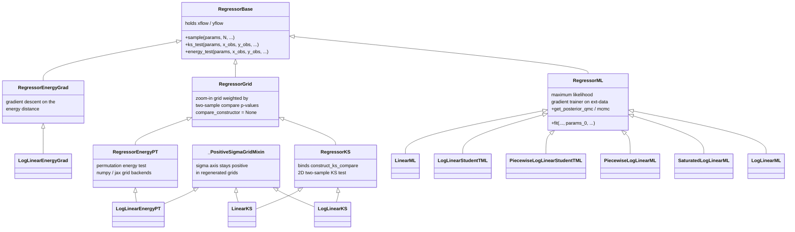

# The regressor hierarchy

`raddest.api.fitter` organizes regressors along two axes: the **fit strategy** (how parameters are chosen) and the **model family** (which parameterization of x → y). One class hierarchy carries both, so reading it by axis keeps the picture small.

## The strategy axis

- **`RegressorML`** — maximum likelihood: the flows are integrated into (x_ext, y_ext, w) points and weights, and a jit-compiled gradient trainer maximizes the weighted log-likelihood. Posterior access via QMC or MCMC on the same machinery.
- **`RegressorGrid`** — distribution-test grid search: each grid point generates a synthetic 2D sample, a two-sample statistic scores it against the observed sample, and the p-value weights the zoom-in grid. The statistic is a bound `compare_constructor`; the base class binds none and `fit` raises without one.
  - **`RegressorKS`** — the KS binding: `construct_ks_compare` (`ndtest.ksnd.ks2d2s`).
  - **`RegressorEnergyPT`** — the energy binding: the permutation energy-distance test, with a `numpy` backend (one joblib worker per grid point) and a `jax` backend (the whole grid as batched matrix products on the GPU). `LogLinearEnergyPT` runs either; cross-backend parity is pinned by `test/test_energy.py` and `test/test_energy_regressors.py`.
- **`RegressorEnergyGrad`** — no grid: the synthetic sample is generated differentiably from the parameters and the energy distance to the observed sample is minimized directly.

## The model axis

`LogLinear*` (y = 10^(k log10 x + b + sig ε)), `SaturatedLogLinear*` (sigmoid-blended exponential tails), `PiecewiseLogLinear*` (segmented with optional equality constraints via `A_eq`/`b_eq`), `*StudentTML` (student-t scatter), and `Linear*` (y = k x + b + sig ε). Each model class picks its scatter function and the strategy superclass; `_PositiveSigmaGridMixin` keeps the sigma grid positive for the grid-based families.

`PiecewiseLogLinearStudentTML` is currently not instantiable — it references a step factory that does not exist; see `TODO.md` for the pending implement-or-remove decision.

## Where the pieces live

- `raddest.api.fitter` — the classes above.
- `raddest.reg.scatter` — scatter families, conditional generators, flow-pair draws, grid parser/printer helpers (statistic-agnostic, shared by all strategies).
- `raddest.reg.ks` — the KS comparators; `raddest.reg.energy` — the energy distance/test and its compare/loss constructors.
- `raddest.reg.constructor` — likelihood/step/generator factories; `raddest.reg.map` — the (obs, err) grid integration; `raddest.reg.func(_jax)` — the model functions and their jax twins.
